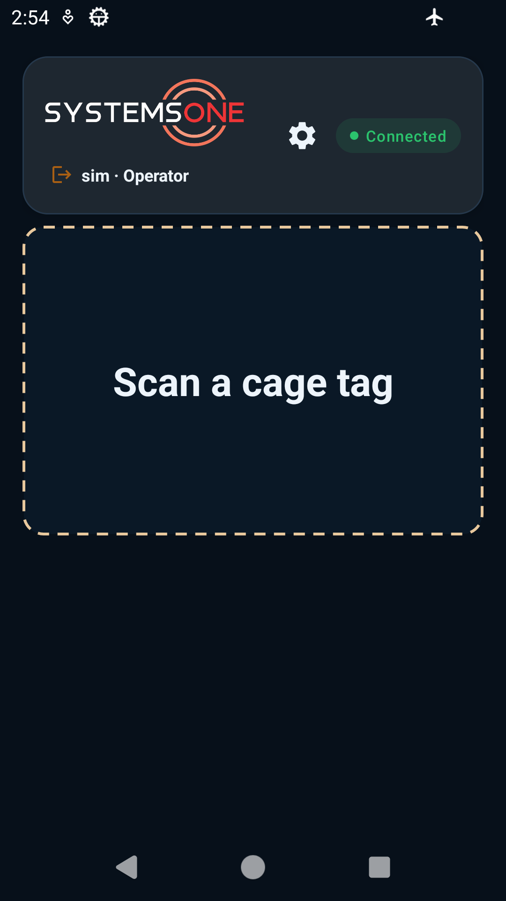
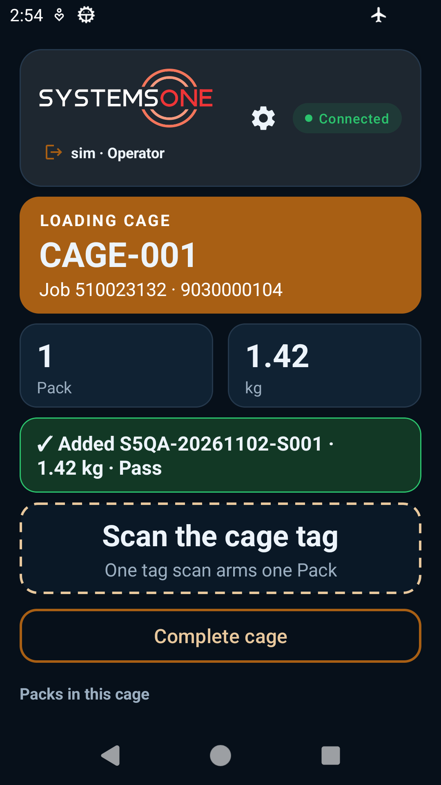
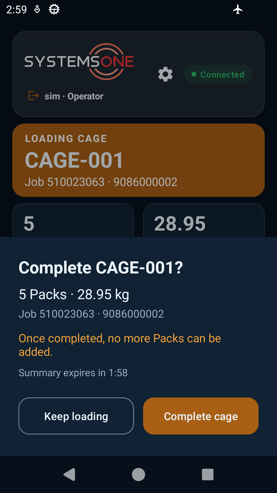
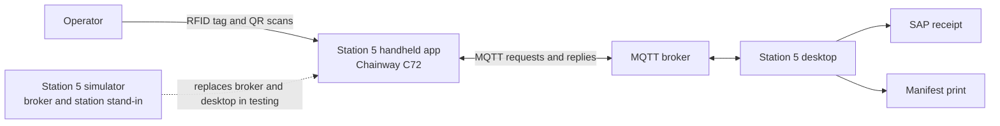

<div align="center">


<h1>PPNAM Station 5 Android</h1>

<p>
The handheld app for cage loading at PPNAM Station 5 (Zone 8).<br>
An operator scans a cage's RFID tag, scans one weighed Pack's QR label to add it to that cage,<br>
and confirms the cage complete. The Station 5 desktop checks and records every scan.
</p>

<p>

&nbsp;&nbsp;&nbsp;&nbsp;
<picture>
  <source media="(prefers-color-scheme: dark)" srcset="docs/assets/systems-one-dark.png">
  
</picture>
</p>

<p>
<a href="https://github.com/Systems-One/PPNAM_Station_5_AA/releases/latest">Latest release (APK)</a> ·
<a href="#documentation">Documentation</a> ·
<a href="docs/sop/PPNAM_Station_5_Handheld_SOP.pdf">Operator SOP (PDF)</a> ·
<a href="docs/superpowers/specs/2026-11-03-cage-loading-design.md">Design spec</a> ·
<a href="tools/station5-sim/README.md">Simulator</a>
</p>

</div>

## Contents

- [What it does](#what-it-does)
- [What the system can do](#what-the-system-can-do)
- [How it fits together](#how-it-fits-together)
- [Status](#status)
- [Get started](#get-started)
- [Install or deploy](#install-or-deploy)
- [Documentation](#documentation)
- [Repository layout](#repository-layout)
- [Reference](#reference)

## What it does

The app runs on the Chainway C72 handheld in the cage-loading area. It is the last step after
Packs have been weighed and approved on the Station 5 desktop: the operator puts each Pack into a
cage and tells the station when the cage is full.

- **One tag scan arms one Pack.** Scan the cage's RFID tag, then scan one Pack's QR label within
  two minutes. Repeat for every Pack.
- **The station decides.** The handheld only shows a Pack as loaded, or a count and weight, once
  the Station 5 desktop has accepted it.
- **A refused Pack stops the operator.** A Pack that must not go into the cage gets a full-screen
  stop, a fail buzz and a vibration.
- **Completing a cage is a deliberate tap.** The operator reviews a summary and confirms. The
  desktop then posts the SAP receipt and prints the manifest; the handheld shows their status.

The app does not weigh Packs, release them from QC, post to SAP, print, or take a Pack out of a
cage. Those are done on the Station 5 desktop.

<p align="center">



</p>

## What the system can do

### Handheld app

Built and unit tested (297 JVM tests pass). Proven on a real Chainway C72 against the simulator
at v1.3.0. Nothing in this repository records a run against the live Station 5 desktop.

| Area | Capability |
|---|---|
| Sign-in | Username and password sign-in checked by the Station 5 desktop (SCRAM). Sign-in needs the `cage_loading` permission. |
| Cage loading | Scan a cage RFID tag to arm it, then scan one Pack QR label within two minutes to add that Pack. |
| Cage view | Shows the active cage's Pack count, total weight and Pack list as the station records them. Scanning another cage's tag switches cage. |
| Refusals | Full-screen stop for a Pack that must not be loaded (for example QC pending, not weighed, already in another cage), with the reason and what to do. |
| Completing a cage | Summary sheet with count and weight, then confirm. Shows SAP receipt and manifest print status afterwards. |
| Lost replies | One request in flight at a time. The exact request is saved and re-sent until the station answers, including after the app is closed, so a Pack is never counted twice. |
| Offline | Blocks scanning with "Station offline" when the broker or the Station 5 desktop is not reachable, and carries on when it is back. |
| Scan feedback | Success chirp with a short vibration when the station accepts a scan; fail buzz with two vibrations when it fails. |
| Session | Auto sign-out after inactivity (15 minutes by default, 0 to 1440). Signs out when the station ends the session. |
| Settings | Diagnostics open to everyone (broker state, station state, version, device ID). Broker settings behind a supervisor PIN, with Test & Apply. The broker password is stored encrypted on the device. |

### Station 5 simulator

Built and tested (51 Node tests pass). A test tool only; it is not installed at the site.

| Area | Capability |
|---|---|
| Broker | An MQTT 3.1.1 broker on port 1883 that the handheld connects to over USB (`adb reverse`). |
| Station stand-in | Answers handheld requests the way the Station 5 desktop does: same validation order, error codes and replies. |
| Demo data | Seeded operators, cages and Packs covering accepted, QC pending, not weighed and manager-accepted cases. |
| Test control | An HTTP control API on `127.0.0.1:8787` to take the station offline, pause it, drop a reply, restart its memory, add a Pack from another device and step the SAP receipt and print states. |

### Delivery

Built and in use: release v1.0.0 was published by this workflow on 2026-11-26.

| Area | Capability |
|---|---|
| Release | Pushing a `v*` tag builds the APK and publishes it as a GitHub Release named `PPNAM_Station_5_AA.apk`. |
| Signing check | The APK is signed with the shared PPNAM keystore. The build fails if the certificate does not match, so updates keep installing on provisioned scanners. |
| Manual build | Running the workflow by hand builds the APK as an artifact without making a release. |
| Operator SOP | A generator builds the SOP as one self-contained HTML file and an A4 PDF from `docs/sop/content.md`. |

## How it fits together



The desktop, the broker, SAP and the printer are not in this repository. The wire contract
between the handheld and the desktop lives in the Station 5 desktop repository
(`PPNAM-Station-5/MQTT_CONTRACT.md`) and is deliberately not copied here.

| Part | What it does | Folder |
|---|---|---|
| App shell | Sign-in, settings, MQTT connection, presence, auto sign-out, session handling | [app/src/main/java/com/mitas/ppnam/station5aa](app/src/main/java/com/mitas/ppnam/station5aa) |
| Cage workflow | Scan routing, requests, saved pending request, refusal messages and the workflow state machine, in plain Kotlin with no Android imports | [app/src/main/java/com/mitas/ppnam/station5aa/cage](app/src/main/java/com/mitas/ppnam/station5aa/cage) |
| Screens and sounds | Layouts, strings, icons and the two scan sounds | [app/src/main/res](app/src/main/res) |
| Unit tests | JVM tests for the shell and the cage workflow | [app/src/test](app/src/test) |
| Simulator | MQTT broker, station stand-in and control API in Node.js | [tools/station5-sim](tools/station5-sim) |
| Release workflow | Builds, checks the signature and publishes the APK | [.github/workflows](.github/workflows) |
| SOP | Operator procedure, its screenshots and the generator | [docs/sop](docs/sop) |

## Status

| Part | State |
|---|---|
| App version | 1.0.0, versionCode 9. Tag and release `v1.0.0`, 2026-11-26. The history also holds 1.2.3 to 1.5.0 and a 2.0.0 release commit; the version was then reset to 1.0.0 across the fleet, with the versionCode raised so handhelds on 2.0.0 can still update. |
| App unit tests | 297 tests in 30 test classes, all passing (`testDebugUnitTest`, run locally on 2026-11-27). |
| Instrumented (on-device) tests | None in the repository. |
| Device simulation | 19 scenarios passed on a Chainway C72 against the simulator. The report is for v1.3.0 (6) on 2026-11-03; there is no later report. |
| Live Station 5 desktop, SQL, SAP, printing | Not covered by any test record in this repository. The simulation report lists these as still needed at the site, along with the physical scanner triggers, production broker TLS and ACLs, real cage tags and printed labels. |
| Badge sign-in | Offered on the Log In screen, but the SOP records that the current Station 5 desktop refuses it. Operators use username and password. |
| Simulator | 51 tests, all passing (`npm test`, run locally on 2026-11-27 with Node 24). It models the desktop at desktop commit `aef7bf7`. |
| Operator SOP | Written for app 1.5.0 (dated 2026-11-06). Its version text and screenshots have not been updated for 1.0.0. |
| CI | One workflow, for releases. It does not run the unit tests; run them before tagging. |

## Get started

You need:

- Android SDK with platform 35, and a JDK. `gradle.properties` pins Gradle to a JDK 21 at a
  Windows path (`C:\Program Files\Android\openjdk\jdk-21.0.8`); on another machine override it
  with `-Dorg.gradle.java.home=<your JDK>`, as the release workflow does with JDK 17.
- Node 22 or newer, only for the simulator.

Build and test the app from the repository root:

```bash
./gradlew --no-daemon testDebugUnitTest
./gradlew --no-daemon assembleDebug
```

Run the simulator and point a USB-connected handheld at it:

```bash
cd tools/station5-sim
npm install
npm test
npm start
adb reverse tcp:1883 tcp:1883
```

The simulator's demo sign-in details and the app's broker settings for it are in
[tools/station5-sim/README.md](tools/station5-sim/README.md).

> [!WARNING]
> A handheld set to the production broker talks to the live Station 5 desktop. Every accepted
> scan allocates a real Pack to a real cage, and confirming a cage complete triggers the SAP
> receipt. Use the simulator for development and testing, and check the broker host in Settings
> before you scan.

## Install or deploy

1. A maintainer pushes a `v*` tag. The release workflow builds `PPNAM_Station_5_AA.apk`, checks
   its signature and attaches it to the GitHub Release.
2. Get the APK from the
   [latest release](https://github.com/Systems-One/PPNAM_Station_5_AA/releases/latest).
3. Install it on the Chainway C72. Because the signature matches, it updates an existing install
   in place.
4. On a new handheld, open Settings, unlock with the supervisor PIN and enter the broker host,
   port, username and password, then tap **Test & Apply**. A new handheld shows **Offline** until
   this is done.
5. Read the **Device ID** from Settings. The Station 5 desktop only answers device IDs it has been
   given.
6. Operators open the app from the **Station 5** tile in the PPNAM Station Launcher and follow the
   [SOP](docs/sop/PPNAM_Station_5_Handheld_SOP.pdf).

How the APK is pushed to the handhelds at the site is not described in this repository.

## Documentation

| I want to | Read |
|---|---|
| Use the app on the floor | [Operator SOP (PDF)](docs/sop/PPNAM_Station_5_Handheld_SOP.pdf) or [Operator SOP (HTML)](docs/sop/PPNAM_Station_5_Handheld_SOP.html) |
| Edit the SOP text | [docs/sop/content.md](docs/sop/content.md) |
| Rebuild the SOP, or learn its layout rules | [docs/sop/_template/README.md](docs/sop/_template/README.md) |
| Understand why the app behaves as it does | [Cage loading design spec](docs/superpowers/specs/2026-11-03-cage-loading-design.md) |
| See how cage loading was built | [Cage loading plan](docs/superpowers/plans/2026-11-03-cage-loading.md) and [rework plan](docs/superpowers/plans/2026-11-03-cage-loading-rework.md) |
| See the UI audit fixes that came before it | [UI audit fixes plan](docs/superpowers/plans/2026-10-02-ui-audit-fixes.md) |
| See what was proven on a real handheld, and what was not | [C72 simulation report](docs/simulation/2026-11-03-c72-simulation.md) |
| Test the app without the desktop, SQL or SAP | [Simulator README](tools/station5-sim/README.md) |
| See how a release is built and signed | [.github/workflows/release.yml](.github/workflows/release.yml) |
| Read the MQTT wire contract | `MQTT_CONTRACT.md` in the Station 5 desktop repository (`PPNAM-Station-5`); not in this repository |

## Repository layout

| Folder | What is in it |
|---|---|
| [.github](.github) | The release workflow |
| [app](app) | The Android app: Kotlin source, resources, unit tests and its Gradle build file |
| [docs](docs) | The operator SOP and its generator, the design spec and plans, the simulation report, and the logos this README uses |
| [gradle](gradle) | The Gradle wrapper and the dependency version catalogue |
| [tools](tools) | The Station 5 simulator |

## Reference

The text of the previous README, unchanged.

<details><summary><b>Summary</b></summary>

Station 5 Zone 8 cage-loading handheld for Packs Rev 2. The operator selects a cage, allocates approved Packs to it and confirms cage completion.

</details>

<details><summary><b>Build and test</b></summary>

```
./gradlew --no-daemon testDebugUnitTest
./gradlew --no-daemon assembleDebug
```

</details>

<details><summary><b>Wire contract</b></summary>

`../PPNAM-Station-5/MQTT_CONTRACT.md` — the only source of truth; do not copy it here.

</details>

<details><summary><b>Design</b></summary>

Spec: [docs/superpowers/specs/2026-11-03-cage-loading-design.md](docs/superpowers/specs/2026-11-03-cage-loading-design.md)

</details>

<details><summary><b>Releases</b></summary>

Releases are cut by pushing a `v*` tag, which triggers the GitHub workflow. This is done manually by a maintainer.

</details>
